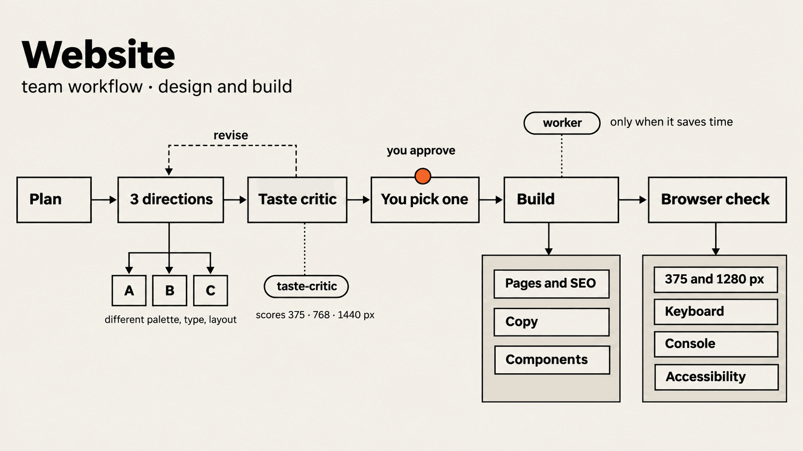
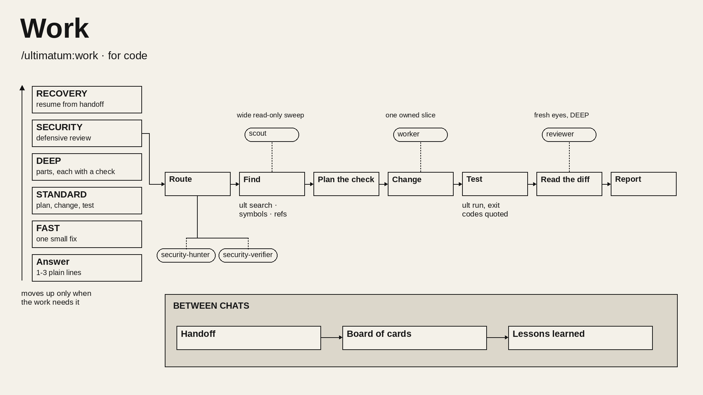

<div align="center">

# Ultimatum

**A website builder for Claude Code.**

Tell it about the business in plain chat. It asks a few questions, writes a one-page brief you approve, shows three design directions, builds the one you pick, checks it in a real browser, and puts nothing live until you say yes.

[](https://github.com/JeffreyScottHamilton/Ultimatum/actions/workflows/ci.yml)


[](LICENSE)

</div>

## Contents

- [What you get](#what-you-get)
- [Install](#install)
- [How it works](#how-it-works)
- [The workflows](#the-workflows): [Website](#website) · [Work](#work)
- [Approvals and checks](#approvals-and-checks)
- [Updates](#updates)
- [Repository layout](#repository-layout)
- [Development](#development)
- [Documentation](#documentation)

## What you get

One plugin with two commands:

| Command | For |
|---|---|
| `/ultimatum:website` | New sites, redesigns and fixes, from small business and local service sites to web apps with sign-in, Supabase and Stripe |
| `/ultimatum:work` | Short answers first, and everyday coding work: fixes, features, debugging, review and releases |

Shops, apps, social media and video are not part of this version.

## Install

```
/plugin marketplace add JeffreyScottHamilton/Ultimatum
/plugin install ultimatum@ultimatum
/ultimatum:setup
```

`/ultimatum:setup` turns on auto-update (see [Updates](#updates)). Each new chat then opens with one line: the version, a self-check, and whether the chat is held to 200K tokens.

## How it works

You never have to pick a command. Each message is sorted locally, with no model call:

- **A question** gets a short, plain answer.
- **A website** ("Build a site for my cafe", or a fix in a website project) goes to `/ultimatum:website`.
- **Code** goes to `/ultimatum:work`, at the smallest level that fits.

A typed command always wins. Start a message with `fast:` or `deep:` to set the level yourself.

| Level | When | What happens |
|---|---|---|
| Answer | A question | One to three plain lines; more only if you ask |
| FAST | One clear spot to change | Change it, run the closest check, done |
| STANDARD | A normal fix or feature | Plan, change, test, read the diff |
| DEEP | Large or spread-out work | Parts with their own checks, a code map, helpers where they save time, one final review |
| SECURITY | A review, audit or risky change | OWASP-based guides; a second agent re-checks every high finding |
| RECOVERY | After a break or a full chat | Reads the handoff, re-checks what is still true, carries on |

## The workflows

How to read the diagrams: orange dots are your approvals, rounded pills are subagents, and dashed lines are optional.

### Website



> "Build a website for my coffee shop"

1. **Intake:** rounds of four questions, each with a recommended answer.
2. **Brief:** one page you approve before any work starts.
3. **Route:** site size, host and domain for your kind of business, with a page list and the proof that works for it.
4. **Three directions:** clearly different HTML pages, scored by the taste critic; you pick one.
5. **Build and check:** built phase by phase, then checked in a real browser at phone, tablet and desktop sizes.
6. **Review:** the compliance reviewer checks claims, licences and links; blockers are fixed and rechecked.
7. **Go live on your yes**, then the first-30-days numbers.

Sites with accounts, saved data or payments add three things: a data model you approve (Supabase, with row-level security tested as a second user), sign-in flows, and Stripe in test mode until you approve real payments.

Small fixes skip the interview and the directions: the bug is seen in the browser, fixed, and checked again.

### Work



> "Fix the CSV export"

1. **Route.** A local router picks the level and lists the few guides worth reading.
2. **Find.** Scoped search; a code map only when the work spans many areas.
3. **Change.** The smallest change that does the job, test first where it can be tested.
4. **Check.** The closest test or command, run in the session. Nothing is called fixed without it.
5. **Review.** Read the diff; DEEP work gets a fresh-eyes reviewer.
6. **Report.** One line of result, with details only when something needs you.

Subagents: `scout` for wide searches, `worker` for one owned slice, `reviewer` for a final read, `security-hunter` and `security-verifier` for audits.

## Approvals and checks

- **A checker on every step.** A browser check for sites and a claims, licences and links review before anything goes live. Findings are fixed and rechecked before you see the work.
- **Approval stops.** Brief, mockup, publish and deploy. Each approval is fingerprinted; if the file changes afterwards, you are asked again.
- **Evidence before claims.** Nothing is reported as fixed or passing without a check run in the session.
- **Local first.** The `ult` toolbelt is Python standard library with no network access. What Ultimatum learns stays on your machine.

## Updates

Claude Code leaves auto-update off for marketplaces added from GitHub. `/ultimatum:setup` backs up your settings and turns it on. To do it by hand, add this to `~/.claude/settings.json` (Windows: `%USERPROFILE%\.claude\settings.json`), merged with what the file already has:

```json
{
  "extraKnownMarketplaces": {
    "ultimatum": {
      "source": { "source": "github", "repo": "JeffreyScottHamilton/Ultimatum" },
      "autoUpdate": true
    }
  }
}
```

Restart Claude Code to pick up a release, or run `claude plugin update ultimatum@ultimatum`. In cloud sessions, install from claude.ai/customize/plugins; `/reload-plugins` picks up an update in a running session.

## Repository layout

```
.claude-plugin/marketplace.json   the marketplace
plugins/ultimatum/                the plugin: website and work skills, references, agents, hooks, ult toolbelt, tests
fixtures/                         small test projects, some with seeded bugs; answer keys in _answer-keys/
evals/live/                       live A/B harness against plain Claude Code, with recorded results
docs/                             credits, coverage map, test report, security review, diagrams
research/                         upstream notes, pinned revisions and architecture decisions
tools/                            maintenance scripts (design-data import)
```

Earlier versions also shipped e-commerce, app, event, social media and video plugins. They were removed in 0.0.5 and can be restored from git (commit `9643d69`).

## Development

```bash
python3 -m unittest discover -s plugins/ultimatum/tests
```

```bash
claude plugin validate . --strict
```

To try a plugin from a clone without installing it:

```bash
claude --plugin-dir ./plugins/ultimatum
```

Live evals (`evals/live/run_live.py`) start real Claude sessions and cost money; `--dry-run` shows the plan and `--max-total-usd` caps the spend. Read [CONTRIBUTING.md](CONTRIBUTING.md) before opening a pull request.

## Documentation

| Document | What is in it |
|---|---|
| [CHANGELOG.md](CHANGELOG.md) | Release notes |
| [docs/TEST-REPORT.md](docs/TEST-REPORT.md) | What was tested live, the results and the open gaps |
| [docs/COVERAGE-MAP.md](docs/COVERAGE-MAP.md) | Every upstream capability and where Ultimatum covers it, or why not |
| [docs/CREDITS.md](docs/CREDITS.md) | Upstream projects, pinned revisions and licences |
| [docs/SECURITY.md](docs/SECURITY.md) | Security review of Ultimatum itself |
| [SECURITY.md](SECURITY.md) | How to report a vulnerability |
| [research/ARCHITECTURE-DECISIONS.md](research/ARCHITECTURE-DECISIONS.md) | Design decisions and their reasons |

## Credits and license

Ultimatum draws on ideas from Superpowers, Matt Pocock's skills, Karpathy's guidelines, gstack, Graphify, OWASP ASVS and WSTG, Impeccable, UI UX Pro Max, shadcn/ui, Radix, GSAP, Playwright and axe-core, among others. All wording and code here are original; every source is listed with its licence in [docs/CREDITS.md](docs/CREDITS.md).

Released under the [MIT License](LICENSE).
