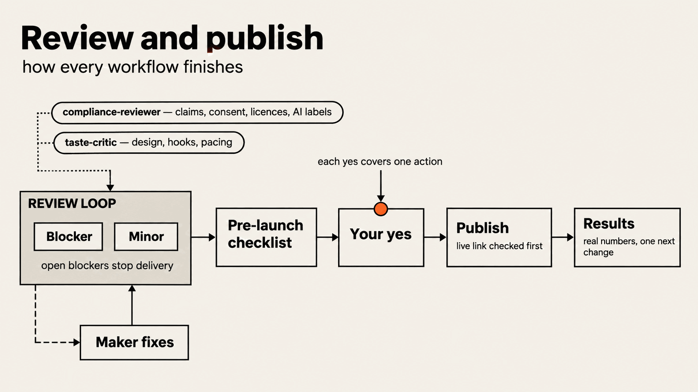
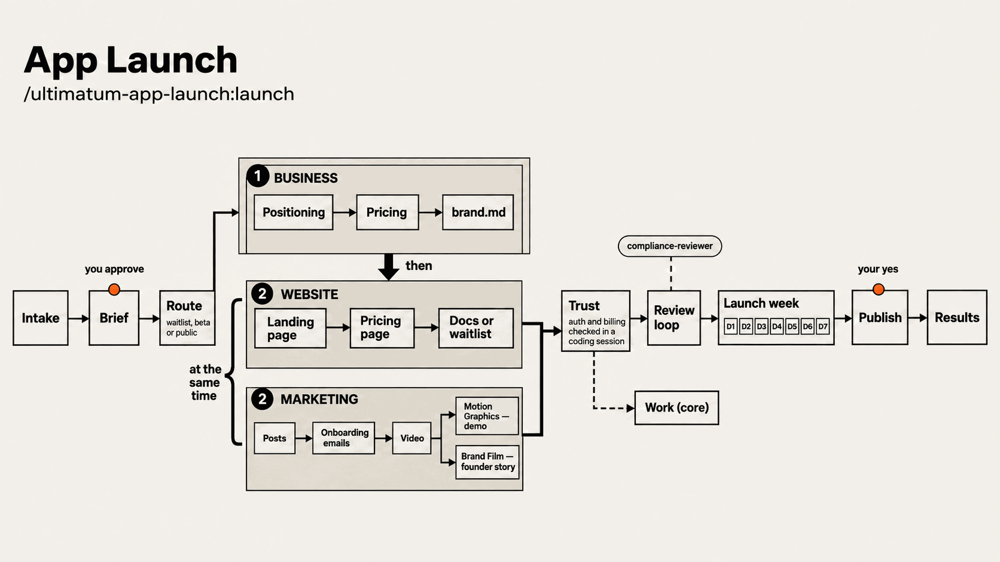
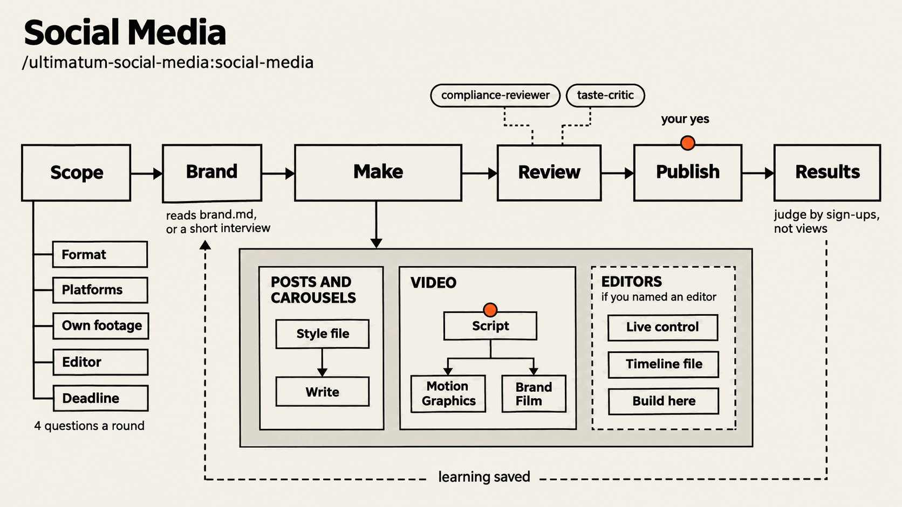

<div align="center">

# Ultimatum

**Build, check and launch with Claude Code.**

Plain chat in. The right workflow out, with a checker on every step and nothing published, posted, deployed or paid for until you say yes.

[](https://github.com/JeffreyScottHamilton/Ultimatum/actions/workflows/ci.yml)


[](LICENSE)

</div>

## Contents

- [What you get](#what-you-get)
- [Install](#install)
- [How it works](#how-it-works)
- [The workflows](#the-workflows): [Work](#work) · [Launches](#launches) · [Social Media](#social-media) · [Video](#video) · [Team workflows](#team-workflows)
- [Approvals and checks](#approvals-and-checks)
- [Updates](#updates)
- [Repository layout](#repository-layout)
- [Development](#development)
- [Documentation](#documentation)

## What you get

Seven plugins from one marketplace. The core is the default way Claude answers; the others are workflows for one kind of job each. Every plugin stands alone and ships everything it needs.

| Plugin | Command | For |
|---|---|---|
| `ultimatum` | `/ultimatum:work` | Short answers first, coding work, and a pointer to the right plugin for everything else |
| `ultimatum-website-launch` | `/ultimatum-website-launch:launch` | Small business, local service, portfolio and creator sites |
| `ultimatum-ecommerce-launch` | `/ultimatum-ecommerce-launch:launch` | Online stores |
| `ultimatum-app-launch` | `/ultimatum-app-launch:launch` | Web apps, mobile apps and subscription products |
| `ultimatum-event-launch` | `/ultimatum-event-launch:launch` | Workshops, classes, webinars, openings, fundraisers and ticketed shows |
| `ultimatum-social-media` | `/ultimatum-social-media:social-media` | Posts, carousels, campaigns and short video |
| `ultimatum-video` | `/ultimatum-video:video` | One finished video: product ad, explainer or brand film |

## Install

```
/plugin marketplace add JeffreyScottHamilton/Ultimatum
/plugin install ultimatum@ultimatum
/ultimatum:setup
```

Then add the plugins for the work you do:

```
/plugin install ultimatum-website-launch@ultimatum
/plugin install ultimatum-ecommerce-launch@ultimatum
/plugin install ultimatum-app-launch@ultimatum
/plugin install ultimatum-event-launch@ultimatum
/plugin install ultimatum-social-media@ultimatum
/plugin install ultimatum-video@ultimatum
```

`/ultimatum:setup` turns on auto-update (see [Updates](#updates)). Each new chat then opens with one line: the version, a self-check, which Ultimatum plugins are on, and whether the chat is held to 200K tokens.

## How it works

You never have to pick a command. Each message is sorted locally, with no model call:

- **A question** gets a short, plain answer.
- **Code** goes to `/ultimatum:work`, at the smallest level that fits.
- **A launch, a post or a video** goes to the plugin made for it. If that plugin is not installed, you get the line to install it.

A typed command always wins. Start a message with `fast:` or `deep:` to set the level yourself.

| Level | When | What happens |
|---|---|---|
| Answer | A question | One to three plain lines; more only if you ask |
| FAST | One clear spot to change | Change it, run the closest check, done |
| STANDARD | A normal fix or feature | Plan, change, test, read the diff |
| DEEP | Large or spread-out work | Parts with their own checks, a code map, helpers where they save time, one final review |
| SECURITY | A review, audit or risky change | OWASP-based guides; a second agent re-checks every high finding |
| RECOVERY | After a break or a full chat | Reads the handoff, re-checks what is still true, carries on |

## The workflows

How to read the diagrams: orange dots are your approvals, rounded pills are subagents, grey panels are team workflows, and dashed lines are optional.

### Work


> "Fix the CSV export"

1. **Route.** A local router picks the level and lists the few guides worth reading.
2. **Find.** Scoped search; a code map only when the work spans many areas.
3. **Change.** The smallest change that does the job, test first where it can be tested.
4. **Check.** The closest test or command, run in the session. Nothing is called fixed without it.
5. **Review.** Read the diff; DEEP work gets a fresh-eyes reviewer.
6. **Report.** One line of result, with details only when something needs you.

Subagents: `scout` for wide searches, `worker` for one owned slice, `reviewer` for a final read, `security-hunter` and `security-verifier` for audits.

### Launches

The four launch plugins share one shape. They open and close the same way and call the same team workflows in the middle, in a fixed order: **Business first**, then **Website**, with the other teams working alongside it.

| Opening | Closing |
|---|---|
|  |  |
| **Intake:** rounds of four questions, each with a recommended answer. **Brief:** one page you approve before any work starts. **Route:** host, domain, size and video style for your kind of business. | **Review loop:** the compliance reviewer and taste critic log problems; blockers are fixed and rechecked. **Launch checklist**, **publish on your yes**, then **results** judged by sign-ups, bookings or sales. |

#### Website Launch


> "Help me launch my coffee shop"

Business sets positioning and writes `brand/brand.md`. Website then proposes three directions, the taste critic reviews them, you pick one, and it is built and checked in a real browser. Social Media drafts the launch posts at the same time.

#### E-commerce Launch


> "Launch my online candle shop"

The Website Launch path plus a store track: catalogue, product photos, payments, tax, shipping and the four policy pages. A real test order runs before launch, and a week-by-week plan covers the first 30 days.

#### App Launch



> "Launch our invoicing app"

Business adds pricing to positioning. Website builds the landing page, pricing page and docs or waitlist while Marketing writes posts and onboarding emails. A **Trust** step checks auth and billing in a coding session, then launch week runs day by day.

#### Event Launch


> "Help me fill my workshop"

A timeline works back from the event date. Then come the event page, sign-ups or tickets with a test purchase, and countdown posts that each get their own yes. It ends with a run sheet for the day and a follow-up after.

### Social Media



> "Make a Reel for our new menu"

**Scope** (format, platforms, footage, editor, deadline) → **Brand** (reads `brand/brand.md`, or writes a short one with you) → **Make** → **Review** of claims, licences and links → **Publish** on your yes → **Results**.

Video without your own footage goes to Motion Graphics for features, numbers and how-it-works, or to Brand Film for a feeling carried by people. Edits can be handed to DaVinci Resolve, Premiere Pro or Final Cut Pro.

### Video


> "Make a 20-second ad for this product"

1. **Intake:** kind, length, aspect ratio, footage, voice, deadline and credit budget.
2. **Script and shots**, which you approve.
3. **Pictures:** Higgsfield for product ads, Motion Graphics for explainers, Brand Film for people, or your own clips. Paid generations show a cost plan first.
4. **Audio:** ElevenLabs voice, then music and effects.
5. **Assemble:** cut to the voice, then the music.
6. **Review:** media checks, stills at every cut, both reviewer agents.
7. **Your yes**, with a licence log for every asset.

### Team workflows

The launch, social and video plugins share these team workflows. Each is a written guide shipped inside the plugin.

| Team | What it does | Diagram |
|---|---|---|
| Business | Interview, positioning, numbers, then `brand/brand.md` | [view](docs/images/team-business.png) |
| Website | Three directions, critic, your pick, build, browser check | [view](docs/images/team-website.png) |
| Social Media | Plan, write, video when it helps, review, your yes | [view](docs/images/team-social-media.png) |
| Video | Chooses the picture source, then voice, music and the cut | [view](docs/images/team-video.png) |
| Motion Graphics | Storyboard, audio sheet, timings, animation | [view](docs/images/team-motion-graphics.png) |
| Brand Film | Story, sourcing, animatic, film, with four approvals | [view](docs/images/team-brand-film.png) |
| Editors | Live control of your editor, a timeline file, or a build here | [view](docs/images/team-editors.png) |

## Approvals and checks

- **A checker on every step.** A browser check for sites, a timestamped review for video, a claims and links review for posts. Findings are fixed and rechecked before you see the work.
- **Approval stops.** Brief, mockup, storyboard, story, sourcing, animatic, video, publish and deploy. Each approval is fingerprinted; if the file changes afterwards, you are asked again.
- **Evidence before claims.** Nothing is reported as fixed or passing without a check run in the session.
- **Local first.** The `ult` toolbelt is Python standard library with no network access. What Ultimatum learns stays on your machine.

## Updates

Claude Code leaves auto-update off for marketplaces added from GitHub. `/ultimatum:setup` backs up your settings and turns it on. To do it by hand, add this to `~/.claude/settings.json` (Windows: `%USERPROFILE%\.claude\settings.json`), merged with what the file already has:

```json
{
  "extraKnownMarketplaces": {
    "ultimatum": {
      "source": { "source": "github", "repo": "JeffreyScottHamilton/Ultimatum" },
      "autoUpdate": true
    }
  }
}
```

Restart Claude Code to pick up a release, or run `claude plugin update ultimatum@ultimatum`. In cloud sessions, install from claude.ai/customize/plugins; `/reload-plugins` picks up an update in a running session.

## Repository layout

```
.claude-plugin/marketplace.json   the marketplace that lists the seven plugins
plugins/
  ultimatum/                      core: work skill, references, agents, hooks, ult toolbelt, tests
  ultimatum-*-launch/             one launch skill each, with copies of the team guides
  ultimatum-social-media/         social media skill
  ultimatum-video/                video skill
teams/                            source of the shared team guides and reviewer agents
tools/sync_plugins.py             copies teams/ into each plugin; CI checks they match
fixtures/                         small test projects, some with seeded bugs; answer keys in _answer-keys/
evals/live/                       live A/B harness against plain Claude Code, with recorded results
docs/                             credits, coverage map, test report, security review, diagrams
research/                         upstream notes, pinned revisions and architecture decisions
```

Edit shared guides only in `teams/`, then run `python3 tools/sync_plugins.py` so every plugin gets the same copy.

## Development

```bash
python3 -m unittest discover -s plugins/ultimatum/tests
```

```bash
python3 tools/sync_plugins.py --check
```

```bash
claude plugin validate . --strict
```

To try a plugin from a clone without installing it:

```bash
claude --plugin-dir ./plugins/ultimatum
```

Live evals (`evals/live/run_live.py`) start real Claude sessions and cost money; `--dry-run` shows the plan and `--max-total-usd` caps the spend. Read [CONTRIBUTING.md](CONTRIBUTING.md) before opening a pull request.

## Documentation

| Document | What is in it |
|---|---|
| [CHANGELOG.md](CHANGELOG.md) | Release notes |
| [docs/TEST-REPORT.md](docs/TEST-REPORT.md) | What was tested live, the results and the open gaps |
| [docs/COVERAGE-MAP.md](docs/COVERAGE-MAP.md) | Every upstream capability and where Ultimatum covers it, or why not |
| [docs/CREDITS.md](docs/CREDITS.md) | Upstream projects, pinned revisions and licences |
| [docs/SECURITY.md](docs/SECURITY.md) | Security review of Ultimatum itself |
| [SECURITY.md](SECURITY.md) | How to report a vulnerability |
| [research/ARCHITECTURE-DECISIONS.md](research/ARCHITECTURE-DECISIONS.md) | Design decisions and their reasons |

## Credits and license

Ultimatum draws on ideas from Superpowers, Matt Pocock's skills, Karpathy's guidelines, gstack, Graphify, OWASP ASVS and WSTG, Impeccable, shadcn/ui, Radix, GSAP, Playwright, axe-core, Higgsfield, ElevenLabs, HyperFrames, ffmpeg and Whisper, among others. All wording and code here are original; every source is listed with its licence in [docs/CREDITS.md](docs/CREDITS.md).

Released under the [MIT License](LICENSE).
