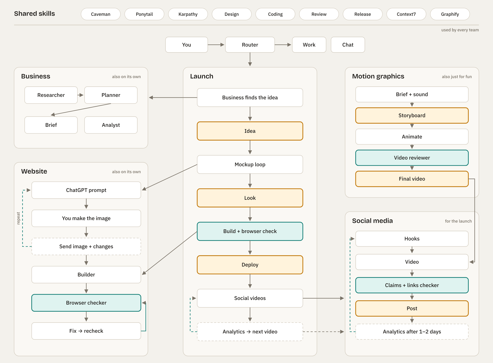
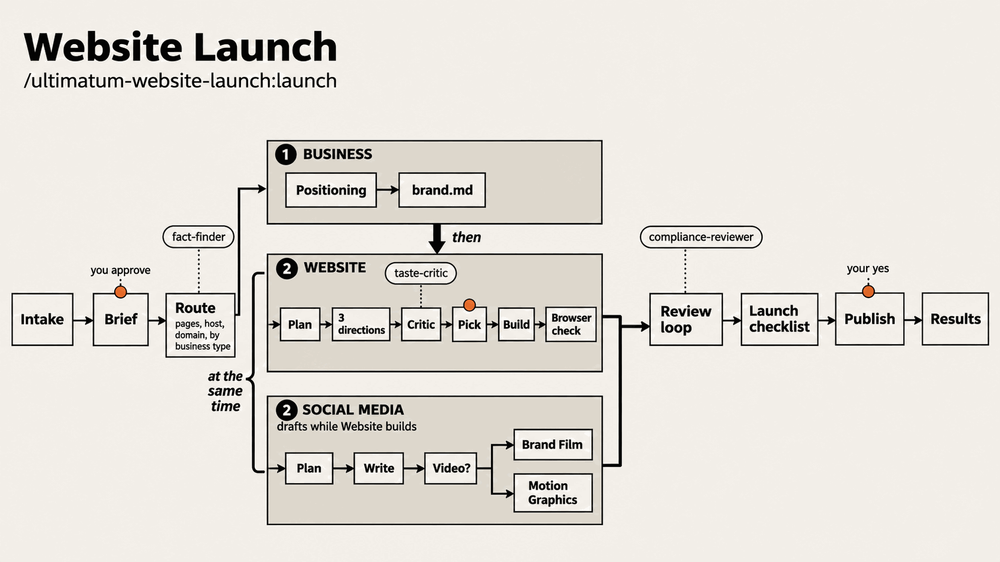
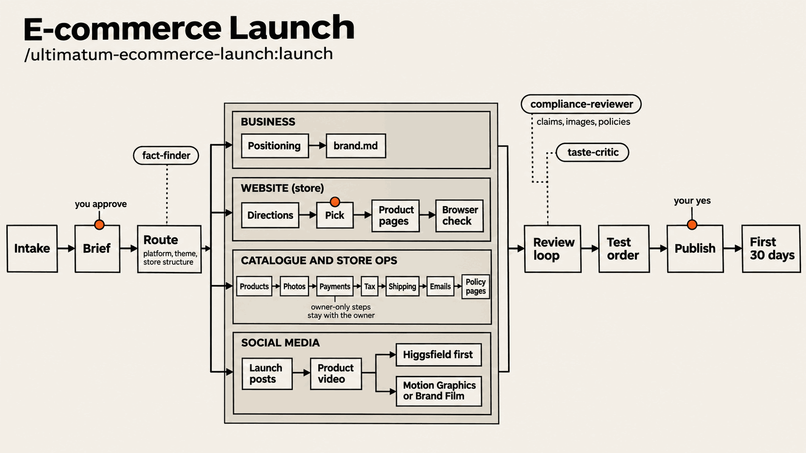
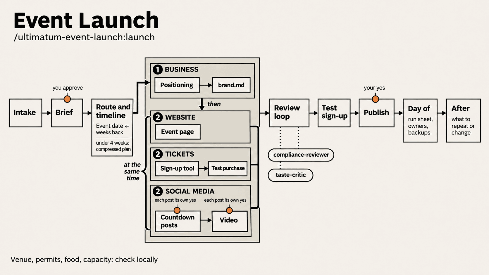
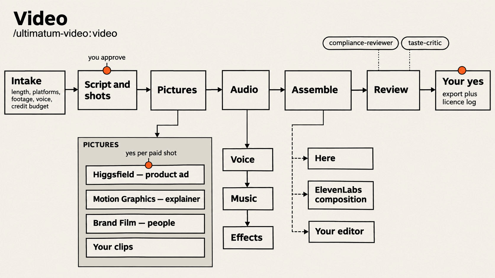
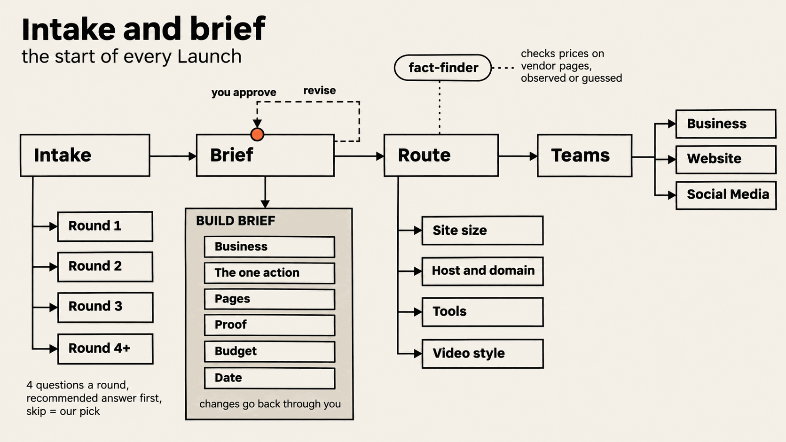

# Ultimatum

**Build, check and launch with Claude Code.** Ask in plain chat: questions get a short answer, code goes to the work skill, and websites, stores, apps, events, social media and video go to the plugin made for them. Every step passes a checker, and nothing is published, posted, deployed or paid for until you approve it.

## Install

```
/plugin marketplace add JeffreyScottHamilton/Ultimatum
/plugin install ultimatum@ultimatum
/ultimatum:setup
```

Add the launch plugin for what you are launching, Social Media on its own for posts, or Video for one finished video. Each one stands alone: it ships its own team guides, reviewer agents and toolbelt, and needs no other plugin.

```
/plugin install ultimatum-website-launch@ultimatum     # small business, local service and portfolio sites
/plugin install ultimatum-ecommerce-launch@ultimatum   # online stores
/plugin install ultimatum-app-launch@ultimatum         # web apps, mobile apps, subscriptions
/plugin install ultimatum-event-launch@ultimatum       # workshops, classes, openings, ticketed events
/plugin install ultimatum-social-media@ultimatum       # posts, carousels and video for social
/plugin install ultimatum-video@ultimatum              # one finished video: ad, explainer, brand film
```

| Plugin | For |
|---|---|
| `ultimatum` | The default: short answers first, coding work, and a pointer to the right plugin for everything else |
| `ultimatum-website-launch` | Launching a small business, local service, portfolio or creator site |
| `ultimatum-ecommerce-launch` | Launching an online store |
| `ultimatum-app-launch` | Launching a web app, mobile app or subscription product |
| `ultimatum-event-launch` | Promoting a workshop, class, webinar, opening, fundraiser or ticketed show |
| `ultimatum-social-media` | Social posts, campaigns and video, with hand-off to DaVinci Resolve, Premiere Pro or Final Cut Pro |
| `ultimatum-video` | One finished video: Higgsfield product ads, motion-graphics explainers, brand films, with ElevenLabs voice, music and effects |

## How Ultimatum answers

Ultimatum is the default once it is on. Every chat starts with one line: its version, that it works, which Ultimatum plugins are on, and whether the chat is held to 200K tokens.

Then it picks the smallest level that fits, and moves up only when the work turns out bigger. Start a message with `fast:` or `deep:` to choose yourself.

| Level | When | What it does |
|---|---|---|
| Answer | A question | 1-3 plain lines first; more only if you ask |
| FAST | One clear spot to change | Change it, run the closest check, done |
| STANDARD | A normal fix or feature | Plan, change, test, read the diff |
| DEEP | Big or spread-out work | Parts with their own checks, a code map, helpers where they save time, one final review |
| SECURITY | A review, audit or risky change | OWASP-based guides; a second agent re-checks high findings |
| RECOVERY | After a break or a full chat | Reads the handoff, re-checks what is still true, carries on |

Anything that is not code goes to the plugin made for it. If that plugin is not installed, you get a short answer and the line to install it.

## The workflows



### Work (core)


"Fix the CSV export" → `/ultimatum:work`. Route, find, change, check, read the diff, report in one line.
Based on: Superpowers, Matt Pocock's skills, Ponytail, Karpathy's guidelines, Caveman, gstack, Graphify, OWASP ASVS and WSTG, Cloudflare's security audit skill.

### Website Launch



"Help me launch my coffee shop" → `/ultimatum-website-launch:launch`. Intake, brief you approve, Business, Website (three directions, a mockup you pick, build, browser check), Social, review, publish on your yes, results.
Based on: Taste, Impeccable, UI/UX Pro Max, shadcn/ui, Radix, GSAP, Playwright, axe-core.

### E-commerce Launch



"Launch my online candle shop" → `/ultimatum-ecommerce-launch:launch`. The Website Launch path plus catalogue, product photos, checkout, a real test order and the first 30 days.
Based on: the Website Launch sources, plus Shopify and WooCommerce setup and licence notes.

### App Launch


"Launch our SaaS invoicing app" → `/ultimatum-app-launch:launch`. Positioning, landing page or docs, pricing and billing, onboarding emails, a security check of auth and billing, launch week day by day.
Based on: the Website Launch sources, plus Ultimatum's own security review.

### Event Launch



"Help me fill my workshop" → `/ultimatum-event-launch:launch`. Event page, sign-up or tickets, countdown posts, a test sign-up, a run sheet for the day, follow-up after.
Based on: the Website Launch and Social Media sources.

### Social Media


"Make a Reel for our new menu" → `/ultimatum-social-media:social-media`. Scope, brand, make, claims and links review, publish on your yes, results by what matters (sign-ups, bookings, sales).
Based on: Ultimatum's own guides, with hand-off to DaVinci Resolve, Premiere Pro or Final Cut Pro.

### Video



"Make a 20-second ad for this product" → `/ultimatum-video:video`. Script and shots you approve, pictures (Higgsfield, motion graphics or film), ElevenLabs voice, music and effects, cut, timestamped review, your yes.
Based on: Higgsfield, ElevenLabs, HyperFrames, ffmpeg, Whisper, librosa, Pexels and Pixabay for licensed footage.

### Shared steps and team workflows

Every launch opens and closes the same way, and calls the same team workflows in its middle.




| Team | Image | What it does |
|---|---|---|
| Business | [team-business.png](docs/images/team-business.png) | Positioning, then `brand/brand.md` |
| Website | [team-website.png](docs/images/team-website.png) | Three directions, critic, your pick, build, browser check |
| Social Media | [team-social-media.png](docs/images/team-social-media.png) | Plan, write, video if it helps, review, your yes |
| Video | [team-video.png](docs/images/team-video.png) | Picks where the pictures come from, then voice, music, cut |
| Motion Graphics | [team-motion-graphics.png](docs/images/team-motion-graphics.png) | Storyboard, audio sheet, timings, animate |
| Brand Film | [team-brand-film.png](docs/images/team-brand-film.png) | Story, sourcing, animatic, film: four yeses |
| Editors | [team-editors.png](docs/images/team-editors.png) | Live control, timeline file, or build it here |

A typed command always wins. Every source is listed with its licence in [`docs/CREDITS.md`](docs/CREDITS.md); all wording and code here are original.

## How it stays honest

- **Checkers on every step.** A browser reviewer for sites, a timestamped reviewer for videos, a claims and links reviewer for posts. Findings are fixed and rechecked before you see the work.
- **Approval stops.** Brief, mockup, storyboard, story, sourcing, animatic, video, publish and deploy. Each approval is fingerprinted, so if the file changes afterwards you are asked again.
- **Evidence before claims.** No "fixed" or "passes" without a check run in the session.
- **Local first.** The toolbelt is Python standard library with no network access, and what Ultimatum learns stays on your machine unless you choose to share it.

See [`plugins/ultimatum/README.md`](plugins/ultimatum/README.md) and the launch plugins' READMEs ([website](plugins/ultimatum-website-launch/README.md), [e-commerce](plugins/ultimatum-ecommerce-launch/README.md), [app](plugins/ultimatum-app-launch/README.md), [event](plugins/ultimatum-event-launch/README.md)) [Social Media](plugins/ultimatum-social-media/README.md) and [Video](plugins/ultimatum-video/README.md) for everything that ships.

## Try it locally

From a clone of this repository:

```bash
claude --plugin-dir ./plugins/ultimatum
```

Then, inside Claude Code:

```
/ultimatum:work slugify drops digits; fix it
```

Or install it through the local marketplace:

```bash
claude plugin marketplace add ./
```

```bash
claude plugin install ultimatum@ultimatum
```

Remove it with `claude plugin uninstall ultimatum@ultimatum`, then `claude plugin marketplace remove ultimatum`.

## Auto-update

Claude Code keeps auto-update off for marketplaces added from GitHub, and a repository cannot turn it on for you. The easiest way: run `/ultimatum:setup` once; it backs up your settings and makes the change below. Or add `"autoUpdate": true` to the marketplace's entry in your user settings, `~/.claude/settings.json` (on Windows, `%USERPROFILE%\.claude\settings.json`):

```json
{
  "extraKnownMarketplaces": {
    "ultimatum": {
      "source": { "source": "github", "repo": "JeffreyScottHamilton/Ultimatum" },
      "autoUpdate": true
    }
  },
  "enabledPlugins": { "ultimatum@ultimatum": true }
}
```

Merge this with what the file already has. Claude Code then updates the marketplace and the plugin when it starts, so restart it to pick up a new release. Claude Code reads this setting only from user settings, not from project settings. A plugin updates only when the version in its `.claude-plugin/plugin.json` changes, and only from the default branch (`main`).

Cloud sessions: install from claude.ai/customize/plugins; each new session downloads the current version. In a session that is already running, `/reload-plugins` picks up an update. Fallback anywhere: `claude plugin update ultimatum@ultimatum`.

## Repository layout

| Path | What it is | Shipped in the plugin? |
|---|---|---|
| `.claude-plugin/marketplace.json` | Marketplace that lists the plugins | — |
| `plugins/ultimatum/` | **The core plugin**: skill, references, agents, toolbelt, schemas, unit tests | yes |
| `plugins/ultimatum-*-launch/` | **The launch plugins**: one head skill each, plus copies of the team guides, agents and toolbelt | yes |
| `plugins/ultimatum-social-media/` | **Social Media**: one head skill plus the same kind of copies | yes |
| `plugins/ultimatum-video/` | **Video**: one head skill plus the same kind of copies | yes |
| `teams/` | Source of the team guides and reviewer agents; `tools/sync_plugins.py` copies them into each head | no (copied) |
| `fixtures/` | Nine small projects used to test Ultimatum, some with seeded bugs and vulnerabilities. Answer keys are in `fixtures/_answer-keys/` | no |
| `evals/live/` | Live A/B harness: Ultimatum vs. plain Claude Code on the fixtures, with deterministic graders | no |
| `plugins/ultimatum/evals/` | `claude plugin eval` routing cases | yes (dev only) |
| `research/` | Upstream research notes, revisions and licenses, and architecture decisions | no |
| `docs/` | Coverage map, credits, test report, routing test, and Ultimatum's own security review | no |

## Development checks

```bash
python3 -m unittest discover -s plugins/ultimatum/tests
```

```bash
claude plugin validate . --strict
```

```bash
claude plugin validate plugins/ultimatum --strict
```

```bash
python3 tools/sync_plugins.py --check
```

```bash
python3 plugins/ultimatum/scripts/ult route --eval plugins/ultimatum/tests/data/routing_holdout.jsonl
```

```bash
python3 evals/live/run_live.py --arms vanilla,v041,v2 --max-total-usd 15 --dry-run
```

Live evals run real Claude sessions and cost money (drop `--dry-run`). Each run's cost is printed and recorded, and the run stops before `--max-total-usd` is exceeded.

## Documents

- [`CHANGELOG.md`](CHANGELOG.md): release notes
- [`research/ultimatum-2/OFFLINE-EVALS.md`](research/ultimatum-2/OFFLINE-EVALS.md): 1.0 offline measurements
- [`docs/TEST-REPORT.md`](docs/TEST-REPORT.md): what was tested live, results, and open gaps
- [`docs/COVERAGE-MAP.md`](docs/COVERAGE-MAP.md): every upstream capability and where Ultimatum covers it, or why it doesn't
- [`docs/CREDITS.md`](docs/CREDITS.md): upstream projects, revisions, and licenses
- [`docs/SECURITY.md`](docs/SECURITY.md): security review of Ultimatum itself
- [`research/ARCHITECTURE-DECISIONS.md`](research/ARCHITECTURE-DECISIONS.md)

License: MIT. This is original work; no upstream code or prose is redistributed.
